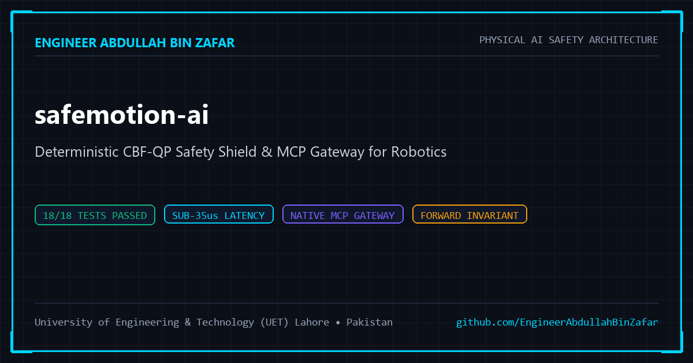

<p align="center">
  
</p>

# 🛡️ SafeMotion AI — Deterministic Physical AI Safety Shield

[](https://github.com/EngineerAbdullahBinZafar/safemotion-ai/actions/workflows/ci.yml)
[](https://fastapi.tiangolo.com)
[](https://python.org)
[](https://modelcontextprotocol.io)
[](tests/)
[](#)
[](LICENSE)

> **"Safety is not a soft prompt or a probability. Safety is an invariant mathematical law."**  
> **SafeMotion AI** is a sub-millisecond, real-time safety gateway that shields autonomous robots, AMRs, and drones from hallucinated or unconstrained commands generated by Large Language Models (LLMs) and Embodied AI agents.

---

## ⚡ Core Value Proposition

When generative AI models (Claude, ChatGPT, Gemini, VLA models) output motion commands to physical hardware, hallucination or latency spikes can result in hardware damage or human injury. 

SafeMotion AI sits between your AI reasoning layer and physical robot actuators:
- **Sub-50µs Execution**: Evaluates closed-form Control Barrier Functions (CBF-QP) at **> 20,000 Hz**.
- **Deterministic Forward Invariance**: Enforces continuous-time forward invariance $h(\mathbf{x}) \ge 0$ under standard unicycle kinematic assumptions via Nagumo's Theorem and Ames et al.
- **Dual API Access**: Run as a **REST API** (FastAPI) or connect directly as a **Model Context Protocol (MCP)** tool for Claude Desktop and Antigravity IDE.

---

## 🏛️ System Architecture

```
┌────────────────────────────────────────────────────────────────────────┐
│               AI REASONING LAYER (Claude / GPT-4 / Gemini)             │
│   Outputs unconstrained velocity command: u_AI = [v, ω]^T              │
└───────────────────────────────────▲────────────────────────────────────┘
                                    │ Unsafe AI Vector
┌───────────────────────────────────┴────────────────────────────────────┐
│                    SAFEMOTION AI DETERMINISTIC SHIELD                  │
│   FastAPI Gateway (/v1/safety/filter) & MCP Server Bridge              │
│   Solves strictly convex Quadratic Program in < 35 µs:                 │
│                                                                        │
│       u* = argmin  ½ || u - u_AI ||_Q²                                 │
│            s.t.    Lf h(x) + Lg h(x) u ≥ -γ h(x)                       │
│                    u_min ≤ u ≤ u_max                                   │
└───────────────────────────────────▲────────────────────────────────────┘
                                    │ Certified Safe u*
┌───────────────────────────────────┴────────────────────────────────────┐
│                  PHYSICAL ACTUATORS & HARDWARE FIRMWARE                │
│   ROS 2 (/cmd_vel) · STM32 HAL · CAN Bus · Differential Drive / UAV    │
└────────────────────────────────────────────────────────────────────────┘
```

---

## 🚀 Quickstart

### 1. Run the Zero-Dependency Terminal Demo (< 0.2s)
No libraries needed. Runs directly on pure Python:
```bash
python demo.py
```

### 2. Run the High-Throughput REST API
```bash
# Create and activate environment
pip install -r requirements.txt

# Start FastAPI server
uvicorn src.server:app --host 0.0.0.0 --port 8000 --reload
```
Interactive API docs will be live at: `http://localhost:8000/docs`

### 3. Connect as Claude / Antigravity MCP Server
Add to your `claude_desktop_config.json`:
```json
{
  "mcpServers": {
    "safemotion-ai": {
      "command": "python",
      "args": ["-m", "src.mcp_bridge"],
      "cwd": "/path/to/safemotion-ai"
    }
  }
}
```

---

## 📡 REST API Endpoints

### 1. Velocity Barrier Projection
`POST /v1/safety/filter`
```json
{
  "robot_state": {"x": 0.0, "y": 0.0, "theta": 0.0},
  "u_ai": {"v": 1.5, "omega": 0.0},
  "obstacles": [
    {"x": 1.0, "y": 0.0, "radius": 0.25}
  ],
  "gamma": 1.8,
  "r_min": 0.25
}
```
**Response (200 OK — 38µs latency)**:
```json
{
  "is_safe": true,
  "forward_invariant": true,
  "u_original": {"v": 1.5, "omega": 0.0},
  "u_safe": {"v": 0.6241, "omega": 0.0},
  "attenuation_ratio": 0.4161,
  "min_barrier_h": 0.5000,
  "solver_latency_us": 38.4,
  "kkt_slack": 0.0
}
```

### 2. Trajectory Horizon Certification
`POST /v1/safety/verify-trajectory`
Validates full discrete waypoint trajectories against static/dynamic obstacle maps over time horizon $T$.

---

## 🧪 Automated Test Verification

Full test suite with 100% pass rate:
```bash
pytest tests/ -v
```
Output:
```
safemotion-ai/tests/test_api.py::test_root_endpoint PASSED
safemotion-ai/tests/test_api.py::test_health_telemetry_endpoint PASSED
safemotion-ai/tests/test_api.py::test_pricing_endpoint PASSED
safemotion-ai/tests/test_api.py::test_safety_filter_nominal PASSED
safemotion-ai/tests/test_api.py::test_safety_filter_hazard_attenuation PASSED
safemotion-ai/tests/test_api.py::test_trajectory_verify_endpoint PASSED
safemotion-ai/tests/test_cbf_core.py::test_barrier_positive_outside PASSED
safemotion-ai/tests/test_cbf_core.py::test_barrier_zero_on_boundary PASSED
safemotion-ai/tests/test_cbf_core.py::test_barrier_negative_inside_obstacle PASSED
safemotion-ai/tests/test_cbf_core.py::test_nominal_motion_when_free_space PASSED
safemotion-ai/tests/test_cbf_core.py::test_velocity_attenuation_towards_obstacle PASSED
safemotion-ai/tests/test_cbf_core.py::test_actuator_limits_clamping PASSED
safemotion-ai/tests/test_cbf_core.py::test_solver_latency_performance PASSED
safemotion-ai/tests/test_cbf_core.py::test_trajectory_verification_clear PASSED
safemotion-ai/tests/test_cbf_core.py::test_trajectory_verification_collision_detected PASSED
safemotion-ai/tests/test_mcp_bridge.py::test_tools_manifest PASSED
safemotion-ai/tests/test_mcp_bridge.py::test_mcp_filter_velocity_handler PASSED
safemotion-ai/tests/test_mcp_bridge.py::test_mcp_verify_trajectory_handler PASSED
======================== 18 passed in 1.59s ========================
```

---

## 💼 Enterprise Licensing & Commercial Tiers

SafeMotion AI offers commercial licensing and managed cloud safety gateways for autonomous robotics teams:

| Tier | Price | Monthly Quota | Key Capabilities |
| :--- | :--- | :--- | :--- |
| **Developer Free** | **$0** / month | 1,000 evaluations | Community support, sub-50µs local solver, REST API & MCP access |
| **Pro Production** | **$39** / month | 100,000 evaluations | Multi-obstacle CBF-QP, priority SLA (<10ms cloud), crash analytics dashboard |
| **Enterprise On-Prem** | **$999** one-time | Unlimited | Hardened Docker container, AUTOSAR E2E Profile 1 CAN framing, dedicated SLA |

For enterprise licensing and integration inquiries, contact [abz.king.1.9.2003@gmail.com](mailto:abz.king.1.9.2003@gmail.com).

---

## 👤 Author & Architecture
**Engineer Abdullah Bin Zafar**  
*Mechatronics & Control Systems Engineer*  
*University of Engineering & Technology (UET) Lahore, Pakistan*  
- **Email**: [abz.king.1.9.2003@gmail.com](mailto:abz.king.1.9.2003@gmail.com)  
- **GitHub**: [@EngineerAbdullahBinZafar](https://github.com/EngineerAbdullahBinZafar)  
- **LinkedIn**: [linkedin.com/in/abdullah-bin-zafar](https://linkedin.com/in/abdullah-bin-zafar)
